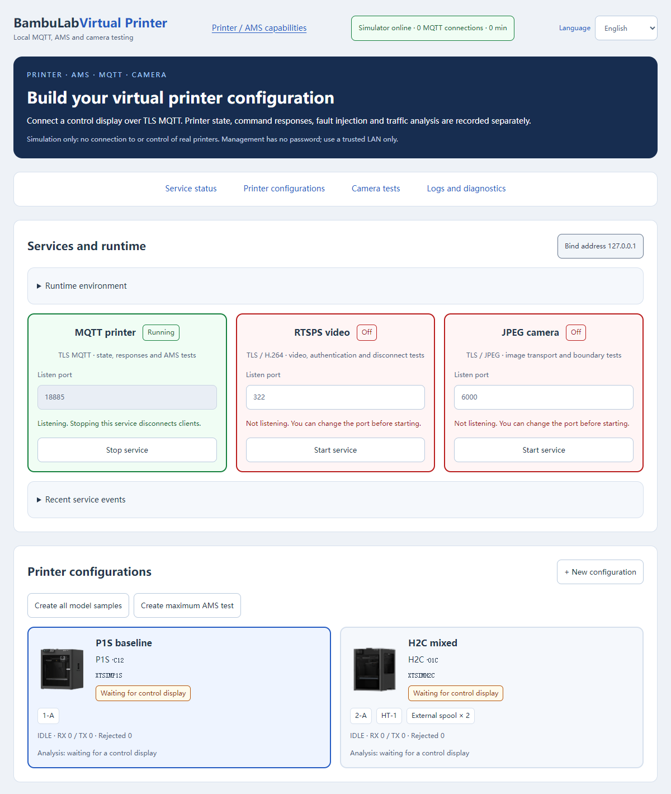
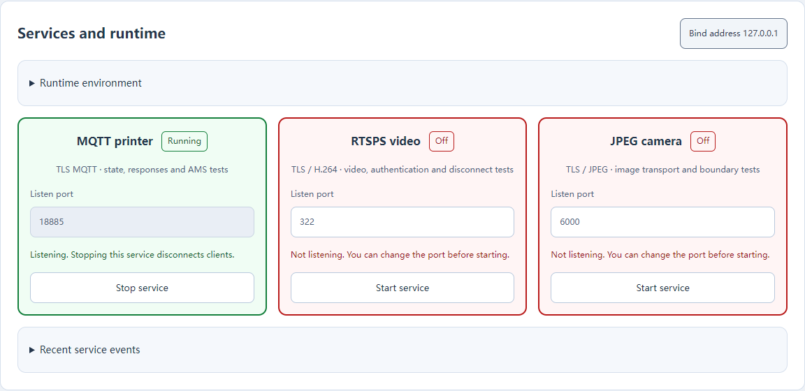
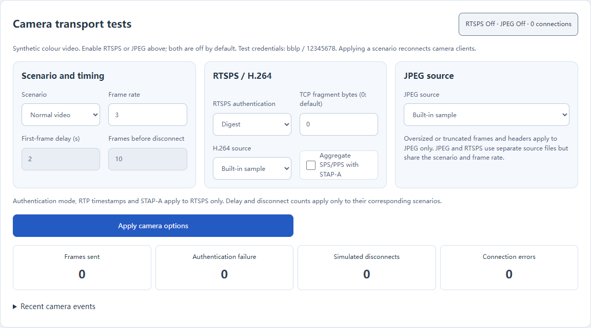
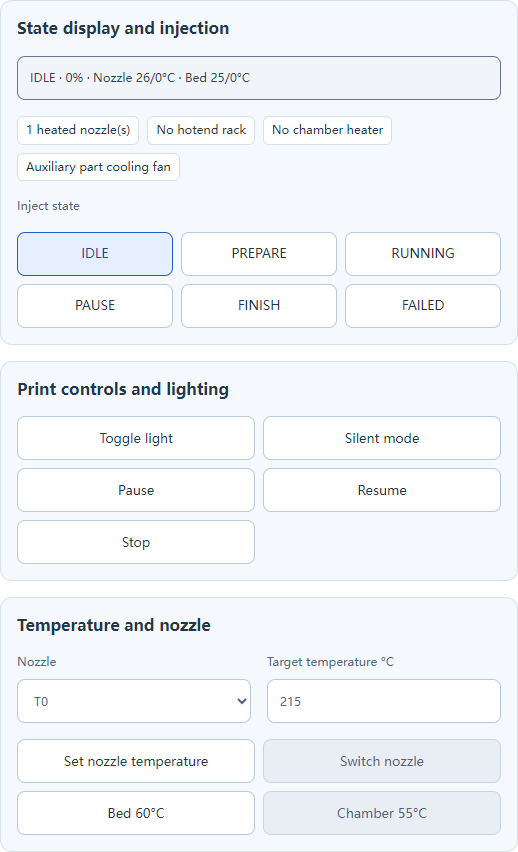
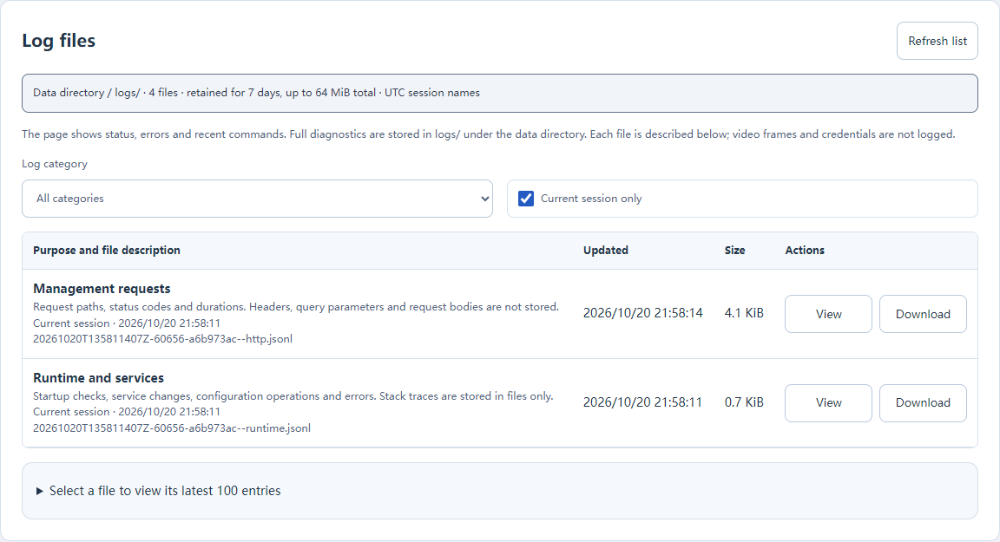

# BambuLab Virtual Printer

[简体中文](README.md) | English

A local Bambu printer and AMS MQTT simulator with web-based combinations, virtual controls, fault injection and communication monitoring. Use it with [xTouch-CN](https://github.com/tbc0309/xTouch-CN) or other clients, without a physical printer, Bambu account or external MQTT broker.

Switch between 简体中文 and English in the header; the selection survives reloads. Success feedback lasts 10 seconds and failures 20 seconds. Hover or focus pauses the countdown; feedback can also be dismissed manually. Service and connection status remain visible.



## Contents

- [Quick start](#quick-start)
- [Connect xTouch-CN](#connect-xtouch-cn)
- [Camera and video tests](#camera-and-video-tests)
- [Create combinations](#create-combinations-and-inspect-communication)
- [Features and testing](#features-and-testing)
- [Logs and diagnostics](#logs-and-diagnostics)
- [Troubleshooting](#troubleshooting-and-limitations)
- [Development and licensing](#development-and-licensing)

## Quick start

Requires Python 3.10+. On Windows, run `start.cmd`. On Linux:

```sh
sh start.sh
```

The launch scripts check Python 3.10+, TLS, bundled resources and cryptography. They create a virtual environment and install dependencies only when missing or incompatible; a ready environment can start offline. Installation errors include a network/pip recovery message. `python bootstrap.py` runs the same checks in an existing environment. Open the [management page](http://127.0.0.1:8894/); no password is required. Launchers listen on all interfaces. Use a trusted LAN only; do not expose the service publicly.

Manual startup:

```sh
python -m pip install -r requirements.txt
python bootstrap.py
# Allow LAN clients and override ports and the data directory
python bootstrap.py --bind 0.0.0.0 --http-port 8894 --mqtt-port 8883 --data-dir ./data
```

| Setting                        | Default                                                                |
| ------------------------------ | ---------------------------------------------------------------------- |
| Web management                 | HTTP 8894                                                              |
| Printer connection             | TLS MQTT 8883                                                          |
| Direct invocation bind address | 127.0.0.1, local only                                                  |
| Local data                     | `data/`: combinations, TLS certificate and private key; ignored by Git |

The computer and control screen must have LAN connectivity. Allow the TCP ports through the firewall. Saved combinations survive restarts.

## Connect xTouch-CN

### Add a LAN device

In xTouch-CN web management, add a LAN device using the computer's LAN IP, access code `12345678` and the virtual `XTSIM…` serial shown on the simulator page. This uses TLS MQTT port 8883 by default.

## Camera and video tests





Start the project and use **Services and runtime** to start/stop MQTT, RTSPS and JPEG and set their ports. No separate camera process is needed. MQTT starts by default; both cameras start disabled on every launch. Camera scenario settings are saved separately. Stop a service before changing its port. The page shows runtime/dependency versions, media readiness and recent service/camera events and a central file catalogue for diagnostic preview/download. Port conflicts or insufficient permissions leave the management page available.

Service cards use green borders for running listeners, red for disabled listeners or startup failures, and amber while switching, with matching text labels. If management becomes unreachable, cards show an unknown state and disable their controls until connectivity returns. Ports accept 1–65535; correct a conflicting port and retry after a startup failure. Duplicate operations are blocked during transitions. Section navigation links to services, printers, cameras and logs. Delay and frame-limit controls are enabled only for their corresponding scenarios; JPEG-only faults are labelled explicitly.

Camera services share the MQTT bind address and local TLS certificate. Optional command-line startup remains available:

```sh
python bootstrap.py --bind 0.0.0.0 --camera-port 322 --jpeg-port 6000
```

Both camera ports are disabled by default. The camera panel shows listening ports, clients and frame counts, and controls scenarios, authentication, TCP fragmentation and source files. Applying options closes existing camera connections; reconnecting clients use the new configuration.

| Interface            | Connection                                                                      |
| -------------------- | ------------------------------------------------------------------------------- |
| RTSPS / H.264        | `rtsps://HOST:322/streaming/live/1`; RTP over TLS/TCP, interleaved channels 0/1 |
| P1/A1-style JPEG/TLS | HOST, TCP 6000; 80-byte authentication and 16-byte frame headers                |
| Fixture credentials  | `bblp` / `12345678`; fixed synthetic test values only                           |

Bundled 320×240 color-pattern fixtures require neither FFmpeg nor a real camera. RTSPS supports Basic/Digest, single NAL units, FU-A, SPS/PPS STAP-A, sequence wraparound, RTCP and keepalive requests. Scenarios include fixed timestamps, delayed first frames, intentional disconnects, connected-without-video and wrong access codes. JPEG additionally supports oversized headers, truncated headers and truncated frame bodies for interrupted-read and reconnect tests; RTSPS authentication, timestamp and aggregation options do not apply to JPEG.

Use these scenarios for X1/X1C/X1E, X2D, P2S and H2-family RTSPS client flows. Resolution, encoding profile and authentication differences are selected through source files and options rather than inferred from a model name.

Put custom H.264 Annex B `.h264` files with SPS/PPS, or complete `.jpg` images, under `data/camera/` (up to 16 MiB per file), then reload the page and select the source. Sources are transmitted without transcoding or downscaling. Use 720p, 1080p or Main Profile samples to exercise client limits; synthetic success does not establish physical model compatibility. Connections end after 900 frames or five minutes, allowing client reconnection tests.

Ports below 1024 may require additional privileges on Linux. Software-only tests can use `--camera-port 1322`; physical clients with fixed ports need the corresponding standard ports available.

### Service control API

`GET /api/services` returns listener state, ports, environment checks and the latest 100 service events. Use a same-origin JSON `POST /api/services` to start or stop a service:

```json
{ "service": "rtsps", "enabled": true, "port": 322 }
```

`service` is `mqtt`, `rtsps` or `jpeg`. Stopping disconnects that service's clients; other services remain available. Ports are 1–65535. Enabled states are not persisted.

### Camera API

`GET /api/camera` returns options, ports, counters, recent events and available sources. `POST /api/camera` accepts an options patch and saves it automatically, using the existing same-origin write checks. Example body:

```json
{
  "mode": "drop",
  "auth": "digest",
  "fps": 3,
  "dropAfter": 10,
  "fragmentBytes": 7,
  "aggregateParameterSets": true
}
```

`mode`: `normal`, `fixed-timestamps`, `delayed`, `drop`, `stall`, `wrong-code`, `oversize`, `truncated-header`, `truncated-frame` (last three: JPEG only). `delaySeconds` sets a first-frame delay of 0–30 seconds. `h264Source` / `jpegSource` accept `fixture` or a filename in the camera data directory, not a path. Options are saved in `data/camera/settings.json`; no real accounts or tokens are needed. Invalid saved settings or missing custom media fall back to the default fixtures at startup and emit a `settings-reset` event. The original file is preserved until valid settings are applied.

## Create combinations and inspect communication



Choose a model, add AMS units with extruder bindings, configure optional external spools and save. Presets generate all model examples or a maximum-address stress combination. Every virtual serial has independent state, subscriptions, events and command counters.

| Combination                | Simulated range                                                                   |
| -------------------------- | --------------------------------------------------------------------------------- |
| AMS / Lite / AMS 2 Pro     | Four slots; unit IDs 0–3                                                          |
| AMS HT                     | One slot; unit IDs 128–135                                                        |
| Lite Mixed                 | ID 16; protocol edge testing                                                      |
| Maximum stress combination | Four four-slot units plus eight HT units, optionally Mixed; no 16-slot truncation |
| Dual nozzle / H2C          | Two heated nozzles with separate bindings; H2C's six-position rack is separate    |
| External spools            | Reported only when configured, independently of AMS units                         |

Nonstandard combinations show warnings and do not imply physical compatibility. Open the capability catalogue in the dashboard to inspect model and AMS support.

After a control-screen action, inspect its MQTT connection count, RX and CHECK events. RX records requests and distinguishes MQTT from WEB; CHECK records validation and replies. TX counts reports queued for subscribers, not confirmed client processing. Each combination retains 200 events; the page shows the latest 40. Full records go to the shared log directory; current state can be downloaded separately as a snapshot.


Incoming control-screen requests highlight the matching buttons and fields for eight seconds without overwriting an active edit. Camera connection changes also highlight their status. Reduced-motion preferences use a static outline instead of pulsing.

## Features and testing

| Feature                         | Simulated behavior                                                                                 |
| ------------------------------- | -------------------------------------------------------------------------------------------------- |
| Printing                        | Idle, preparation, running, pause, finish and failure; progress and layers advance                 |
| Temperature, light, speed, fans | Legacy and newer temperature fields, virtual heating/cooling and capability checks                 |
| AMS                             | Material, color, remaining amount, humidity, loading/unloading, RFID and extruder bindings         |
| Drying                          | Pro 45–65°C, HT 45–85°C; 1–24 hours, with minutes in telemetry                                     |
| Multiple nozzles and rack       | T0/T1 temperatures, switching, cold-extrusion rejection and rack-command responses                 |
| Fault injection                 | Rejection codes, missing command ACKs, delays, dropped reports, hidden model, HMS and print errors |

Code `9001` means an invalid simulator parameter or an unsupported command; it is not an official Bambu code. Unsupported commands do not return false success. Injected rejections do not apply the corresponding state change.

### Deltas and state patches

- **State patch** updates runtime state and emits a full report. It does not save that runtime state into the restart configuration.
- **One-shot delta** emits only the supplied payload, without changing runtime state or immediately appending a full report.
- **Pause automatic reports** prevents the two-second full reports from masking missing-field or invalid-value tests. Virtual time, commands and manual pushes continue; commands may still generate status replies. Resume automatic reports when finished.

Up to 100 virtual combinations, 24 MQTT connections and eight concurrent connections per camera service are supported. Each MQTT client has a bounded outbound queue. Overflow or a write exceeding five seconds disconnects that client. CONNECT keepalive is honored; `0` disables the keepalive timeout.

### Regression tests

```sh
python -m unittest -v selftest camera_test diagnostics_test
```

Tests cover model/AMS state, temperature and drying limits, bindings, external spools, cold extrusion, TLS authentication, QoS 0/1, topic isolation, keepalive, slow clients, deltas and cross-origin write protection.

The read-only P1S comparison sends only `get_version` and `pushall`, with no action commands:

```sh
python compare_p1s.py --config /private/xtouch-backup.json --output /private/p1s-summary.json
```

Keep credential-bearing backups outside the repository. Output excludes credentials, real serial numbers, topics and print filenames.

## Logs and diagnostics



The **Log files** panel lists each file's purpose, filename, run/session, update time and size. Filter the current run or previous runs, preview the latest 100 records, or download the original file.

| Output                | Dashboard                                                                                      | Saved records                                                                                                                       |
| --------------------- | ---------------------------------------------------------------------------------------------- | ----------------------------------------------------------------------------------------------------------------------------------- |
| Runtime/services      | Listener state, ports, current error summaries and the latest 10 service events                | Startup checks, dependency installation, configuration actions and browser error summaries and backend exception details/tracebacks |
| Printer communication | Connections, counters and the latest 40 commands/validation results; expand payloads on demand | Commands, validation, connections and reports sent to subscribers; full state sampled at most once per device every 2 seconds       |
| Camera                | Active clients, frame/authentication/disconnect counts and the latest 10 significant events    | Protocol/authentication/disconnect events; frame statistics sampled at most once per transport per second                           |
| Management HTTP       | Action results and errors                                                                      | Method, path, status and duration; successful polling requests are file-only                                                        |

Logs live under `data/logs/`, or `logs/` within a custom `--data-dir`. Files are UTF-8 JSONL: one JSON record per line. Names use UTC:

```text
<YYYYMMDD>T<HHMMSSmmm>Z-<PID>-<sessionID>--<channel>.jsonl
20261020T063012123Z-1234-a1b2c3d4--mqtt.jsonl
```

| Channel      | Purpose                                                                             |
| ------------ | ----------------------------------------------------------------------------------- |
| `runtime`    | Startup, services, configuration and exceptions                                     |
| `mqtt`       | Printer and AMS communication                                                       |
| `camera`     | RTSPS/JPEG camera transport                                                         |
| `http`       | Management page/API requests                                                        |
| `comparison` | Read-only comparison summaries, created only when the optional tool is run manually |

`index.json` is the file catalogue with descriptions, updated at startup, file creation/rotation, catalogue refresh and normal shutdown. `.1`, `.2`, `.3` are rotated files, newest first. Limits: 2 MiB per file, three backups per channel/session, seven days, 128 files and 64 MiB total. Cleanup runs at startup, file creation and rotation. Storage failures produce a dashboard warning without stopping simulation.

Passwords, tokens, access codes and authorization fields are redacted. HTTP headers, bodies and query values are not logged; video frames are never saved. Preview/download accepts only regular files in the log directory. **Download state snapshot** downloads a virtual-device state snapshot on demand; it is separate from diagnostic log files.

`GET /api/logs` lists files; `GET /api/logs/tail?name=filename` previews recent records; `GET /api/logs/file?name=filename` downloads a file. Unhandled browser errors submit a summary and script location to `POST /api/logs/client`, without collecting forms, DOM or browser storage. These endpoints use the management API's Host validation.

## Troubleshooting and limitations

| Problem                                          | Check                                                                                                 |
| ------------------------------------------------ | ----------------------------------------------------------------------------------------------------- |
| Page works locally but the screen cannot connect | Use the computer's LAN IP, bind to `0.0.0.0`, and check firewall rules and ports                      |
| Port already in use                              | Stop the old instance or override `--http-port` / `--mqtt-port` and update the client                 |
| Delta is quickly overwritten                     | Pause automatic reports; check for control commands or manual full pushes                             |
| RFID or drying rejected                          | Check AMS type, slot, binding, temperature, duration and busy state; Lite has neither RFID nor drying |

The simulator never forwards commands to real printers. FTP, real cloud authentication, complete mechanical and rack workflows, and drying physics are not emulated. MQTT is a test subset without QoS2, wildcard subscriptions, retained messages, persistent sessions or will delivery. Protocol tests for newer models do not establish physical printer validation.

## Development and licensing

Run the regression suite with `python -m unittest -v selftest camera_test diagnostics_test`. The dashboard uses native JavaScript and requires no frontend build. `model.py` implements printer state and commands; MQTT, cameras, service management and diagnostics have separate modules. `catalog.json` records capability snapshots and upstream sources.

Source is distributed under GPLv3. See [License and attribution](LICENSE.md) for image, capability-data and dependency notices.
