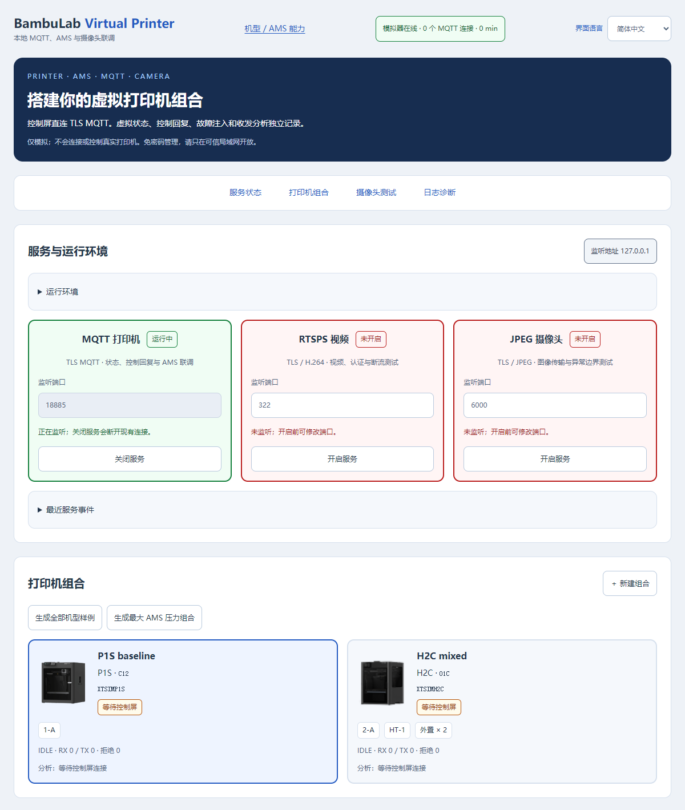
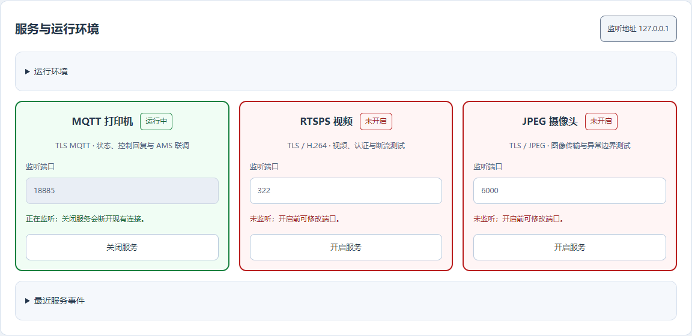
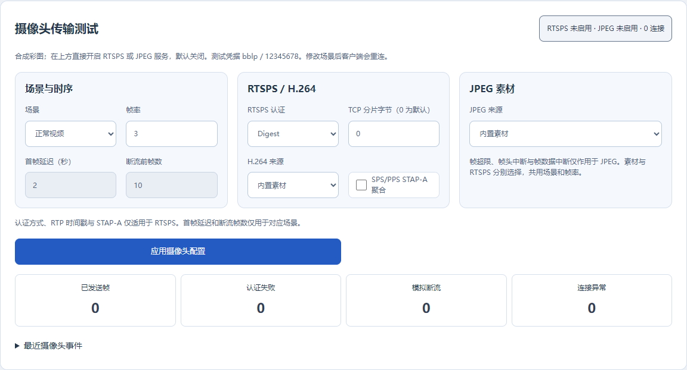
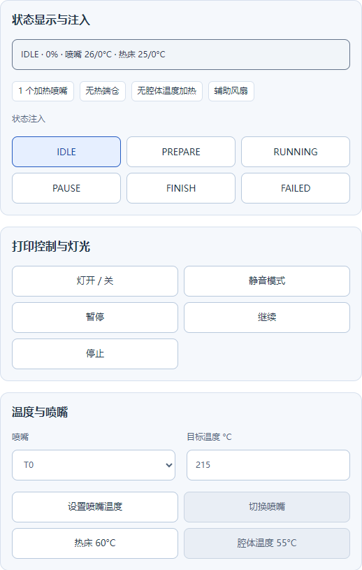
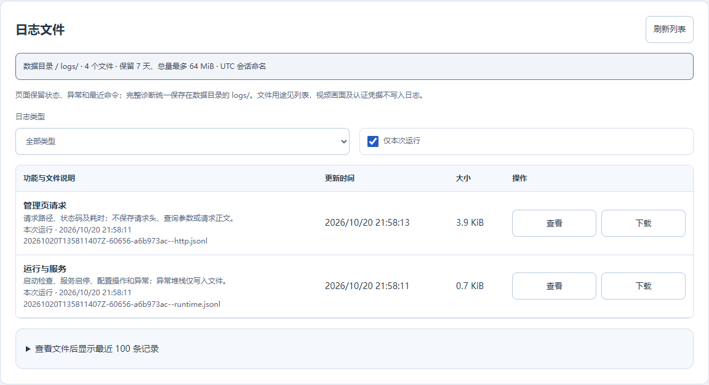

# BambuLab Virtual Printer

简体中文 | [English](README.en.md)

本地运行的拓竹打印机与 AMS MQTT 模拟器，提供网页组合管理、虚拟控制、故障注入和通信监控。可用于 [xTouch-CN](https://github.com/tbc0309/xTouch-CN) 等客户端联调，无需真实打印机、拓竹账号或外部 MQTT Broker。

页面右上角支持简体中文 / English 切换，刷新后保留选择。操作成功提示保留 10 秒、失败提示 20 秒；悬停或聚焦可暂停，也可手动关闭。服务和连接状态持续显示。



## 目录

- [快速启动](#快速启动)
- [连接 xTouch-CN](#连接-xtouch-cn)
- [摄像头与视频测试](#摄像头与视频测试)
- [创建组合与检查通信](#创建组合与检查通信)
- [功能与测试方法](#功能与测试方法)
- [日志与诊断](#日志与诊断)
- [常见问题与限制](#常见问题与限制)
- [开发与许可](#开发与许可)

## 快速启动

需要 Python 3.10+。Windows 双击 `start.cmd`；Linux 执行：

```sh
sh start.sh
```

启动时检查 Python 3.10+、TLS、项目资源及 cryptography 版本，自动创建虚拟环境；仅在依赖缺失或版本不符时安装，已就绪时可离线启动。安装失败会显示网络或 pip 检查提示。打开 [管理页面](http://127.0.0.1:8894/)，无需管理密码。启动脚本监听所有网卡；请仅在可信局域网使用，不要映射到公网。

手动启动：

```sh
python -m pip install -r requirements.txt
python bootstrap.py
# 允许局域网控制屏连接，并自定义端口及数据目录
python bootstrap.py --bind 0.0.0.0 --http-port 8894 --mqtt-port 8883 --data-dir ./data
```

| 项目               | 默认值                                                |
| ------------------ | ----------------------------------------------------- |
| 网页管理           | HTTP 8894                                             |
| 打印机连接         | TLS MQTT 8883                                         |
| 手动运行的监听地址 | 127.0.0.1，仅本机                                     |
| 本地数据           | `data/`：组合、TLS 证书、摄像头选项及日志，不提交 Git |

连接实体控制屏时，电脑与控制屏须在可互通的局域网，并放行上述 TCP 端口。重新启动保留已保存的组合。

## 连接 xTouch-CN

### 添加局域网设备

在 xTouch-CN 网页后台添加局域网设备，填写电脑的局域网 IP、访问码 `12345678` 和管理页面显示的虚拟序列号 `XTSIM…`。此方式默认使用 TLS MQTT 8883。

## 摄像头与视频测试





启动项目后，在管理页“服务与运行环境”直接开启或关闭 MQTT、RTSPS 和 JPEG，并设置端口，无需另外运行摄像头程序。MQTT 默认开启，两个摄像头服务默认关闭，每次启动恢复此默认状态；摄像头场景参数单独保存。运行中的端口不可编辑，先关闭再修改。服务与摄像头的最近事件可展开查看，详细日志在“日志文件”集中预览和下载，页面同时显示 Python、TLS、依赖版本及内置媒体状态。端口冲突或权限不足时显示错误，管理页仍可使用。

服务卡片以绿色边框表示运行中、红色表示未开启或启动失败、黄色表示切换中；同时显示文字状态。管理连接中断时显示“状态未知”并暂时禁用开关。端口范围为 1–65535，启动失败可修改端口后重试；切换期间禁止重复提交。顶部导航可直达服务、组合、摄像头和日志。摄像头延迟与断流参数仅在对应场景可编辑，JPEG 专属异常会标明适用范围。

摄像头与 MQTT 使用同一个监听地址和本地 TLS 证书，也保留命令行预先开启方式：

```sh
python bootstrap.py --bind 0.0.0.0 --camera-port 322 --jpeg-port 6000
```

默认两个摄像头端口均关闭，可点击管理页按钮开启。网页“摄像头传输测试”显示实际监听端口、连接数及帧计数，可切换场景、认证方式、TCP 分片和媒体来源；应用后已有摄像头连接断开，客户端重新连接以使用新配置。

| 接口              | 连接方式                                                              |
| ----------------- | --------------------------------------------------------------------- |
| RTSPS / H.264     | `rtsps://电脑IP:322/streaming/live/1`；RTP over TLS/TCP，交织通道 0/1 |
| P1/A1 类 JPEG/TLS | 电脑 IP、TCP 6000；80 字节认证和 16 字节帧头                          |
| 测试认证          | 用户 `bblp`，访问码 `12345678`，仅为模拟器固定测试值                  |

内置 320×240 合成彩图，无需 FFmpeg 或真实摄像头。RTSPS 支持 Basic / Digest、单 NAL、FU-A、SPS/PPS STAP-A、序号回绕与 RTCP/保活请求。可模拟固定时间戳、延迟首帧、主动断流、连接无画面、错误访问码；JPEG 还支持超限帧头、帧头中断和帧数据中断，可检查半包退出与重连恢复。JPEG 不使用 RTSPS 的认证、时间戳及聚合选项。

可用于 X1/X1C/X1E、X2D、P2S 和 H2 系列客户端的 RTSPS 流程测试；型号相关的画面分辨率、编码档次和认证差异由所选样本与场景组合表达。

自定义视频放到 `data/camera/`，使用带 SPS/PPS 的 H.264 Annex B `.h264` 或完整 `.jpg` 文件，单文件不超过 16 MiB。重载网页后选择文件；服务器直接发送源数据，不转码、不降低分辨率。可用 720p、1080p、Main Profile 等样本检查客户端的支持范围，模拟成功不代表所有实体机支持相同码流。每次连接最多发送 900 帧或持续 5 分钟，随后由客户端重连。

Linux 上低于 1024 的端口可能需要额外权限；纯软件测试可使用 `--camera-port 1322`。实体控制屏若使用固定端口，则需让对应标准端口可用。

### 服务控制 API

`GET /api/services` 返回监听状态、端口、环境检查结果及最近 100 条服务事件。`POST /api/services` 使用同源 JSON 请求启停服务：

```json
{ "service": "rtsps", "enabled": true, "port": 322 }
```

`service` 为 `mqtt`、`rtsps` 或 `jpeg`。关闭服务会断开对应客户端，其他服务继续运行；端口范围 1–65535，启停状态不持久化。

### 摄像头 API

`GET /api/camera` 返回当前选项、端口、计数、最近事件和可选源文件；`POST /api/camera` 接收选项补丁并自动保存。写操作沿用现有的同源校验。示例请求体：

```json
{
  "mode": "drop",
  "auth": "digest",
  "fps": 3,
  "dropAfter": 10,
  "fragmentBytes": 7,
  "aggregateParameterSets": true
}
```

`mode`：`normal`、`fixed-timestamps`、`delayed`、`drop`、`stall`、`wrong-code`、`oversize`、`truncated-header`、`truncated-frame`（后三项仅 JPEG）；`delaySeconds` 为首帧延迟 0–30 秒。`h264Source` / `jpegSource` 为 `fixture` 或数据目录内的文件名，不接受路径。场景设置保存在 `data/camera/settings.json`，不包含真实账号或 Token。配置损坏或自定义源文件丢失时，启动使用默认彩图，事件显示 `settings-reset`；原配置保留，重新应用有效设置即可修复。

## 创建组合与检查通信



选择机型，添加 AMS 类型及绑定喷头，按需设置外置耗材后保存。也可生成全部机型样例或最大 AMS 压力组合。每个虚拟序列号具有独立状态、订阅、日志及命令计数。

| 组合                   | 模拟范围                                               |
| ---------------------- | ------------------------------------------------------ |
| AMS / Lite / AMS 2 Pro | 四槽，单元 ID 0–3                                      |
| AMS HT                 | 单槽，单元 ID 128–135                                  |
| Lite Mixed             | ID 16，用于协议边界测试                                |
| 最大压力组合           | 4 个四槽单元 + 8 个 HT，另可叠加 Mixed；不截断为 16 槽 |
| 双喷头 / H2C           | 两个加热喷头分别绑定；H2C 六位热端仓单独处理           |
| 外置耗材               | 仅配置后上报，双路外置独立于 AMS                       |

非标准组合会显示警告，不代表真实硬件兼容。机型与 AMS 能力可在管理页的能力目录查看。

在控制屏操作后，检查对应组合的 MQTT 连接数、RX 和 CHECK 事件：RX 为收到的请求，日志区分 MQTT / WEB 来源；CHECK 为参数校验及回复；TX 统计进入订阅者发送队列的报文，不代表客户端已处理。每组合保留最近 200 条事件，界面展示最近 40 条；完整记录写入统一日志目录，当前状态可另行下载快照。

局域网连接验证可仅使用 `bblp` 和访问码连接，再订阅对应序列号的 `device/…/report`。订阅成功后立即返回状态，无需发送控制命令；访问码错误会拒绝连接，未知序列号会拒绝订阅。


控制屏发来的操作会在当前虚拟打印机对应的按钮和输入框上高亮 8 秒；正在编辑的输入不会被覆盖。摄像头连接变化也会高亮状态区，减少动态效果设置会将闪烁改为静态提示。

## 功能与测试方法

| 功能                 | 已模拟的行为                                                   |
| -------------------- | -------------------------------------------------------------- |
| 打印                 | 空闲、准备、运行、暂停、完成、失败；推进进度及层数             |
| 温度、灯、速度、风扇 | 传统与新协议温度、虚拟升降温及能力校验                         |
| AMS                  | 材料、颜色、剩余量、湿度、进退料、RFID 与喷头绑定              |
| 烘干                 | Pro 45–65°C，HT 45–85°C；1–24 小时，状态按分钟表示             |
| 多喷头及热端仓       | T0/T1 设温、切换、冷挤出拒绝及热端仓命令回复                   |
| 故障注入             | 拒绝码、不回命令 ACK、延迟、停止推送、隐藏型号、HMS / 打印错误 |

错误 `9001` 是模拟器参数或未实现命令错误，不属于拓竹官方码表。未实现命令不会返回假成功，注入拒绝码时不执行对应状态修改。

### 增量与状态补丁

- **合并状态补丁**：修改当前组合的运行状态，并发送完整状态；不保存为重启后的组合配置。
- **发送单次增量**：只发送填写的报文，不修改运行状态，也不立即追加完整状态。
- **暂停自动上报**：用于观察缺字段或异常报文，避免每两秒的完整状态覆盖测试结果。虚拟时间、控制命令和手动推送继续工作，命令仍可触发状态回复；测试后点击“恢复自动上报”。

最多保存 100 个虚拟组合；MQTT 最多 24 个连接，每个摄像头服务最多 8 个并发连接。每个 MQTT 客户端有独立的有界发送队列。队列积压或写入超过 5 秒会断开该客户端。保活按 CONNECT 参数处理，`0` 表示不启用保活超时。

### 回归测试

```sh
python -m unittest -v selftest camera_test diagnostics_test
```

覆盖机型 / AMS 状态、设温及烘干范围、绑定、外置、冷挤出、TLS 认证、QoS 0/1、主题隔离、保活、慢连接隔离、增量和 HTTP 防跨站写入。

真实 P1S 只读对照工具仅发送 `get_version` / `pushall`，不发送动作命令：

```sh
python compare_p1s.py --config /private/xtouch-backup.json --output /private/p1s-summary.json
```

备份含凭据，应放在项目外。只读对照摘要默认写入统一日志目录的 `comparison` 文件，`--output` 可额外保存一份快照。输出不含凭据、真实序列号、主题或打印文件名。

## 日志与诊断



管理页的“日志文件”按功能列出说明、文件名、运行会话、时间和大小，可筛选本次运行或历史记录，查看最近 100 条记录并下载原文件。

| 输出       | 页面显示                                                 | 文件记录                                                                      |
| ---------- | -------------------------------------------------------- | ----------------------------------------------------------------------------- |
| 运行与服务 | 启停状态、端口、当前异常摘要；最近 10 条服务事件         | 启动检查、依赖安装结果、配置操作、浏览器异常摘要、后端异常详情和堆栈          |
| 打印机通信 | 连接数、收发计数、最近 40 条命令与校验结果；报文按需展开 | 命令、校验、连接生命周期及发给订阅者的状态；完整状态每设备最多每 2 秒记录一次 |
| 摄像头     | 活动连接、帧数、认证/断流计数、最近 10 条重要事件        | 协议请求、认证、断流和帧统计；帧记录每传输类型最多每秒一次                    |
| 管理 HTTP  | 操作结果及错误提示                                       | 请求方法、路径、状态和耗时；正常轮询不在页面逐条展示                          |

日志统一写入 `data/logs/`；使用 `--data-dir` 时随数据目录移动。文件采用 UTF-8 JSONL，每行一个 JSON 记录。文件名为：

```text
<UTC年月日>T<时分秒毫秒>Z-<进程号>-<会话ID>--<功能>.jsonl
20261020T063012123Z-1234-a1b2c3d4--mqtt.jsonl
```

| 功能标识     | 说明                                                           |
| ------------ | -------------------------------------------------------------- |
| `runtime`    | 启动、服务、配置和异常                                         |
| `mqtt`       | 打印机与 AMS 通信                                              |
| `camera`     | RTSPS / JPEG 摄像头传输                                        |
| `http`       | 管理页及 API 访问                                              |
| `comparison` | 只读对照工具的结果摘要，手动运行后生成；不会自动连接真实打印机 |

`index.json` 保存文件目录及用途说明，启动、创建/轮转文件、刷新列表和正常退出时更新。`.1`、`.2`、`.3` 是由新到旧的轮转文件。单文件 2 MiB、每类每会话最多 3 个备份；日志保留 7 天，最多 128 个文件、总量 64 MiB，启动、创建日志文件和轮转时清理。目录不可写时页面提示，模拟功能继续运行。

密码、Token、访问码及认证字段脱敏；不记录 HTTP 请求头、正文和查询参数，不保存视频帧。文件预览及下载只接受日志目录中列出的普通文件。“下载当前状态快照”是按需下载的虚拟设备状态，不是日志文件。

`GET /api/logs` 获取文件目录，`GET /api/logs/tail?name=文件名` 查看最近记录，`GET /api/logs/file?name=文件名` 下载文件。浏览器未处理异常会提交错误摘要及脚本位置到 `POST /api/logs/client`，不采集表单、DOM 或浏览器存储。接口沿用管理页的 Host 检查。

## 常见问题与限制

| 问题                     | 检查方法                                                                  |
| ------------------------ | ------------------------------------------------------------------------- |
| 电脑能打开，控制屏连不上 | 使用电脑局域网 IP，启动时指定 `--bind 0.0.0.0`，检查防火墙与端口          |
| 端口被占用               | 停止旧实例，或用 `--http-port` / `--mqtt-port` 修改端口，并同步客户端配置 |
| 增量很快被覆盖           | 暂停自动上报；检查是否还有控制命令或手动完整推送                          |
| RFID / 烘干被拒绝        | 核对 AMS 类型、槽位、绑定、温度、时长及忙碌状态；Lite 无 RFID 和烘干      |

模拟器不会向真实打印机转发命令。FTP、真实云端鉴权、完整机械运动及换热端流程、材料干燥物理过程均未模拟。MQTT 是测试用子集，不支持 QoS2、通配符订阅、保留消息、持久会话或遗嘱投递。新机型的协议测试不代表对应实体打印机已验证。

## 开发与许可

运行回归测试：`python -m unittest -v selftest camera_test diagnostics_test`。网页使用原生 JavaScript，无需前端构建。打印机状态与命令位于 `model.py`，MQTT、摄像头、服务管理及诊断分别位于同名模块；能力快照与上游来源记录在 `catalog.json`。

本项目采用 GPLv3。打印机图片与能力数据的来源、授权及依赖说明见 [许可证与素材归属](LICENSE.md)。
